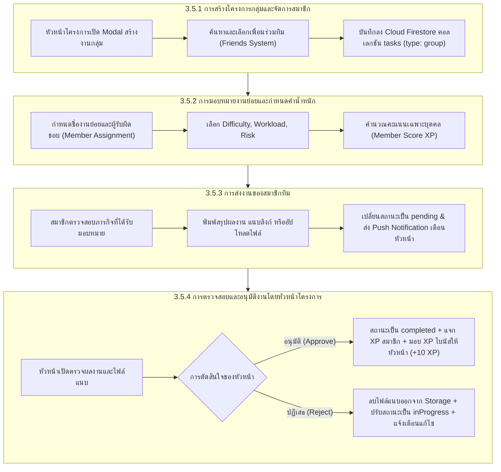
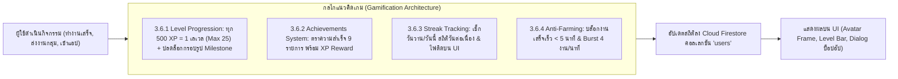

# บทที่ 3 (ต่อ): ส่วนที่ 2 การพัฒนาระบบโครงการกลุ่มและระบบแนวคิดเกม (Phase 2)
**แอปพลิเคชันบริหารจัดการแผนงานและติดตามสถานะภาระงาน (Personal Workflow and Task Progress Monitoring Application)**
*หลักสูตรวิทยาศาสตรบัณฑิต สาขาวิชาวิทยาการคอมพิวเตอร์ มหาวิทยาลัยเทคโนโลยีราชมงคลสุวรรณภูมิ*

---

## 3.5 การพัฒนาระบบโครงการกลุ่มและการทำงานร่วมกัน (Group Projects and Collaboration System)

ระบบโครงการกลุ่มได้รับการออกแบบขึ้นเพื่อแก้ไขปัญหาความยุ่งยากในการประสานงานและการติดตามความคืบหน้าของงานที่ต้องทำร่วมกันเป็นทีม โดยประยุกต์ใช้สถาปัตยกรรมแบบรวมศูนย์ข้อมูลบนคลาวด์ (Cloud-based Centralized Architecture) ผ่านบริการ Cloud Firestore ร่วมกับ Cloud Storage สำหรับจัดเก็บไฟล์เอกสารและผลงานของสมาชิกในทีม โดยจำแนกฟังก์ชันหลักออกเป็น 4 ส่วน ได้แก่ การสร้างโครงการกลุ่มและจัดการสมาชิก, การมอบหมายงานย่อยและการกำหนดค่าน้ำหนักงาน, กระบวนการส่งงานของสมาชิก, และกระบวนการตรวจสอบและอนุมัติงานโดยหัวหน้าโครงการ



---

### 3.5.1 การสร้างโครงการกลุ่มและการจัดการสมาชิก (Group Project Creation and Member Management)

ในการพัฒนาระบบภาระงานกลุ่ม คณะผู้จัดทำได้เลือกใช้รูปแบบโครงสร้างข้อมูลแบบรวมศูนย์ในคอลเลกชัน `tasks` ร่วมกับภาระงานส่วนบุคคล โดยจำแนกประเภทด้วยฟิลด์ `type: 'group'` เพื่อลดความซ้ำซ้อนของโค้ดในการสืบค้นข้อมูล และรองรับการดึงข้อมูลทั้งสองประเภทผ่าน Stream ชุดเดียวกันได้อย่างมีประสิทธิภาพ

#### 1. ส่วนต่อประสานผู้ใช้และการโต้ตอบ (UI & Interaction Layer)
การสร้างภาระงานกลุ่ม ผู้ใช้จะต้องเปิดหน้าต่างโมดอล `CreateTaskModal` โดยมีกระบวนการและองค์ประกอบทาง UI ดังต่อไปนี้:
* **การสลับโหมดภาระงาน:** ป็อปอัปสวิตช์สำหรับเลือกระหว่าง "งานส่วนตัว (Personal Task)" หรือ "งานกลุ่ม (Group Task)"
* **การเลือกเพื่อนร่วมทีม (Member Picker):** ดึงรายชื่อเพื่อนที่เชื่อมโยงกันในระบบเพื่อน (Friends System) แสดงผลเป็นตารางรายชื่อพร้อมรูปโปรไฟล์และปุ่มเครื่องหมายถูก ผู้สร้างสามารถค้นหาเพื่อนตามชื่อหรือเลือกหลายคนพร้อมกันได้
* **การระบุหัวหน้าโครงการ (Project Leader):** ผู้สร้างภาระงานจะได้รับสิทธิ์เป็นหัวหน้าโครงการ (`creatorId`) โดยอัตโนมัติ ซึ่งมีสิทธิ์สูงสุดในการแก้ไขรายละเอียด มอบหมายงาน และอนุมัติผลงานของทุกคนในทีม

> **ภาพที่ 3-xx** ส่วนต่อประสานผู้ใช้การสร้างภาระงานกลุ่มและการเลือกสมาชิกในทีม (Create Group Task Modal)
> *(คำอธิบายภาพ: แสดงหน้าต่างการกรอกข้อมูลโครงการกลุ่ม ชื่อโครงการ กำหนดเวลาส่ง และช่องการเลือกสมาชิกเพื่อนร่วมทีมพร้อมรูปประจำตัว)*

#### 2. โครงสร้างข้อมูลบน Cloud Firestore (Data Structure Layer)
เมื่อหัวหน้าโครงการกดยืนยันการสร้างงาน ระบบจะจัดเก็บข้อมูลลงใน Cloud Firestore คอลเลกชัน `tasks` โดยมีฟิลด์หลักที่เกี่ยวข้องกับการทำงานกลุ่มดังแสดงในตารางที่ 3-xx:

**ตารางที่ 3-xx** โครงสร้างฟิลด์สำหรับภาระงานกลุ่มในคอลเลกชัน `tasks`

| ชื่อฟิลด์ (Field Name) | ชนิดข้อมูล (Data Type) | ความหมายและหน้าที่การทำงาน |
| :--- | :--- | :--- |
| `id` | String | รหัสเอกสารระบุภาระงานกลุ่มแบบไม่ซ้ำซ้อน (Primary Key) |
| `title` | String | หัวข้อหรือชื่อของโครงการกลุ่ม |
| `description` | String | รายละเอียด วัตถุประสงค์ หรือคำชี้แจงของโครงการ |
| `type` | String | ระบุประเภทภาระงานเป็น `'group'` |
| `creatorId` | String | รหัสผู้ใช้ที่เป็นหัวหน้าโครงการและเป็นผู้สร้างงาน (Leader UID) |
| `assigneeIds` | Array\<String\> | รายการรหัสผู้ใช้ของสมาชิกทุกคนที่ได้รับมอบหมายงานในโครงการนี้ |
| `members` | Array\<Map\> | อาเรย์ของออบเจกต์เก็บข้อมูลเฉพาะของสมาชิกแต่ละคน (ชื่องานย่อย, คะแนน, ไฟล์แนบ, สถานะ) |
| `dateTime` | Timestamp | วันที่และเวลาครบกำหนดส่งของโครงการกลุ่ม (Deadline) |
| `priority` | String | ลำดับความสำคัญของโครงการ (`Low`, `Medium`, `High`) |
| `status` | String | สถานะภาพรวมของโครงการกลุ่ม (`inProgress`, `pending`, `completed`) |
| `deletedForUserIds` | Array\<String\> | รายการรหัสสมาชิกที่เลือกซ่อนหรือลบงานนี้ออกจากหน้าจอของตนเอง |

#### 3. โค้ดส่วนการจัดการสถานะและการบันทึกข้อมูล (Implementation Code)
การบันทึกภาระงานกลุ่มลงใน Cloud Firestore จะประมวลผลผ่านเมธอด `addTask` ในคลาส `TaskProvider` ([`lib/providers/task_provider.dart`](file:///c:/Users/A/OneDrive/Desktop/todoapp/lib/providers/task_provider.dart)):

```dart
// =========================================================================
// 3.5.1 การเตรียมข้อมูลและบันทึกภาระงานกลุ่มลงบน Cloud Firestore
// =========================================================================
Future<void> addTask(Task task) async {
  final currentUserId = _currentUserId ?? _auth.currentUser?.uid;
  if (currentUserId == null) return;

  // ตรวจสอบกรณีเป็นงานกลุ่ม (Group Task)
  final isGroupTask = task.isGroup;
  
  // รวบรวมรายชื่อผู้รับผิดชอบทั้งหมด (Assignees) รวมถึงหัวหน้าโครงการ
  final effectiveAssigneeIds = isGroupTask
      ? (task.assigneeIds.isEmpty ? [currentUserId] : task.assigneeIds)
      : [currentUserId];

  final taskData = task.copyWith(
    creatorId: currentUserId,
    assigneeIds: effectiveAssigneeIds,
    createdAt: DateTime.now(),
    isDeleted: false,
  );

  // เพิ่มข้อมูลลง Local State ชั่วคราวเพื่อให้ UI ตอบสนองแบบ Optimistic Update
  _tasks.add(taskData);
  notifyListeners();

  // บันทึกลง Cloud Firestore ในคอลเลกชัน 'tasks'
  await _firestore.collection('tasks').doc(taskData.id).set(
    taskData.toMap(),
    SetOptions(merge: true),
  );
}
```

> **ภาพที่ 3-xx** โค้ดเมธอด `addTask` สำหรับบันทึกภาระงานกลุ่มลงใน Cloud Firestore
> *(คำอธิบายภาพ: แสดงการเตรียมรายชื่อผู้รับผิดชอบ `effectiveAssigneeIds` การกำหนด `creatorId` และการบันทึกเอกสารลงบนคอลเลกชัน `tasks`)*

---

### 3.5.2 การมอบหมายงานย่อยและการกำหนดค่าน้ำหนักงาน (Subtask Assignment and Workload Weighting)

จุดเด่นของระบบการจัดการงานกลุ่มในแอปพลิเคชันนี้ คือ ความสามารถในการกระจายงานย่อยให้แก่สมาชิกแต่ละคนอย่างเป็นอิสระ โดยสมาชิกแต่ละคนไม่จำเป็นต้องได้รับภาระงานหรือคะแนนที่เท่ากัน หัวหน้าโครงการสามารถประเมินความยาก ปริมาณงาน และความเสี่ยงของแต่ละส่วนงานเพื่อคำนวณคะแนน XP ที่ยุติธรรม

#### 1. ส่วนต่อประสานผู้ใช้การกำหนดค่างานของสมาชิก (Member Config UI)
เมื่อหัวหน้าโครงการเลือกสมาชิกเข้าสู่โครงการแล้ว ระบบจะเปิดชีต `MemberConfigSheet` หรือหน้าจอ `MemberAssignmentDetailScreen` เพื่อให้หัวหน้าทีมระบุรายละเอียดเฉพาะบุคคล ดังนี้:
* **หัวข้องานย่อยและคำอธิบาย (Task Title & Description):** กำหนดว่าสมาชิกคนดังกล่าวมีหน้าที่รับผิดชอบส่วนใดในโครงการ
* **รายการงานย่อยที่ต้องทำ (Checklist Subtasks):** หัวหน้าสามารถเพิ่มข้อกำหนดงานย่อยให้สมาชิกติ๊กถูกตรวจสอบความสมบูรณ์ก่อนส่งงาน
* **ตัวเลือกประเมินค่าน้ำหนัก (Weighting Parameters):**
  1. *ระดับความยาก (Difficulty):* ง่าย (Easy), ปานกลาง (Medium), ยาก (Hard)
  2. *ปริมาณเนื้องาน (Workload):* น้อย (Small), ปานกลาง (Medium), มาก (Large)
  3. *ระดับความเสี่ยง (Risk Level):* ต่ำ (Low), กลาง (Medium), สูง (High)
* **กล่องแสดงผลคะแนน XP สด (Live XP Calculator):** ระบบจะคำนวณและแสดงผลคะแนน XP ที่สมาชิกจะได้รับทันทีที่มีการเปลี่ยนตัวเลือกน้ำหนักงาน

> **ภาพที่ 3-xx** หน้าจอการมอบหมายงานย่อยและการปรับค่าน้ำหนักคะแนน XP รายบุคคล (Member Assignment Screen)
> *(คำอธิบายภาพ: แสดงองค์ประกอบของแบบฟอร์มกำหนดงานย่อย ตัวเลือก Difficulty, Workload, Risk และผลการคำนวณคะแนน XP)*

#### 2. โมเดลคณิตศาสตร์การคำนวณคะแนน XP ของสมาชิก (Mathematical XP Formulation)
การคำนวณคะแนน XP ที่ระบบแนะนำสำหรับงานย่อยของสมาชิก ($XP_{suggested}$) ในหน้าต่าง `MemberConfigSheet` และคลาส `Task` คำนวณจากฟังก์ชันผลรวมถ่วงน้ำหนักของระดับความซับซ้อน ปริมาณงาน และความเสี่ยง ดังสมการที่ (3.1):

$$XP_{suggested} = (S_{diff} \times 15) + (S_{load} \times 10) + (S_{risk} \times 5)$$

โดยแปลงค่าระดับที่เลือกเป็นค่าคะแนนสเกลตัวคูณ ($S$) ดังแสดงในตารางที่ 3-xx:

**ตารางที่ 3-xx** ค่าระดับคะแนนสเกลสำหรับการคำนวณคะแนน XP แนะนำรายบุคคล

| มิติการประเมิน (Metric Dimension) | ค่าระดับ (Level Label) | ค่าคะแนนสเกล ($S$) | ค่าน้ำหนักตัวคูณ (Weight Factor) |
| :--- | :--- | :---: | :---: |
| **ระดับความยาก (Difficulty / Complexity)** | ง่าย (Easy)<br>ปานกลาง (Medium / Normal)<br>ยาก (Hard) | 1<br>2<br>3 | 15 XP |
| **ปริมาณเนื้องาน (Workload)** | น้อย (Small)<br>ปานกลาง (Medium / Normal)<br>มาก (Large) | 1<br>2<br>3 | 10 XP |
| **ระดับความเสี่ยง (Risk Level)** | ต่ำ (Low / None)<br>กลาง (Medium / Normal)<br>สูง (High) | 1<br>2<br>3 | 5 XP |

จากการกำหนดค่าน้ำหนักดังกล่าว คะแนนแนะนำที่ระบบคำนวณให้จะอยู่ในช่วงระหว่าง **30 ถึง 90 XP** ดังนี้:
* *ระดับต่ำสุด (ง่าย / งานน้อย / ความเสี่ยงต่ำ):* $(1 \times 15) + (1 \times 10) + (1 \times 5) = 30\text{ XP}$
* *ระดับมาตรฐาน (ปานกลาง / งานกลาง / ความเสี่ยงกลาง):* $(2 \times 15) + (2 \times 10) + (2 \times 5) = 60\text{ XP}$
* *ระดับสูงสุด (ยาก / งานมาก / ความเสี่ยงสูง):* $(3 \times 15) + (3 \times 10) + (3 \times 5) = 90\text{ XP}$

นอกจากนี้ ในกรณีที่ผู้รับผิดชอบเป็นสมาชิกในทีม ระบบยังเปิดโอกาสให้หัวหน้าโครงการสามารถปรับแต่งค่าคะแนนเฉพาะบุคคลได้อย่างอิสระ (Manual Override) ผ่านช่องป้อนตัวเลขได้ตั้งแต่ **1 ถึง 100 XP** แต่หากภาระงานย่อยนั้นเป็นงานที่หัวหน้าทีมรับผิดชอบเอง ระบบจะคำนวณและล็อกค่าคะแนนตามสูตร $XP_{suggested}$ โดยอัตโนมัติ เพื่อป้องกันการกำหนดคะแนนให้ตนเองสูงเกินจริง

#### 3. โค้ดส่วนการจัดเก็บออบเจกต์ Member (Implementation Code)
โครงสร้างข้อมูลของสมาชิกแต่ละคนถูกจัดเก็บเป็นอินสแตนซ์ของคลาส `Member` ในไฟล์ [`lib/models/task.dart`](file:///c:/Users/A/OneDrive/Desktop/todoapp/lib/models/task.dart):

```dart
// =========================================================================
// 3.5.2 โครงสร้างข้อมูลคลาส Member สำหรับบันทึกรายละเอียดงานย่อยของสมาชิก
// =========================================================================
class Member {
  final String id;
  final String name;
  final String avatarUrl;
  final String? taskTitle;
  final String? description;
  final String difficulty;
  final String workload;
  final String risk;
  final List<String> subTasks;
  final List<String> completedSubTasks;
  final String? score; // คะแนน XP ที่คำนวณได้สำหรับสมาชิกคนนี้
  final String? submissionText;
  final DateTime? submittedAt;
  final String status; // 'inProgress', 'pending', 'completed'
  final List<TaskAttachment> attachments;

  const Member({
    required this.id,
    required this.name,
    this.avatarUrl = '',
    this.taskTitle,
    this.description,
    this.difficulty = 'Easy',
    this.workload = 'Small',
    this.risk = 'Low',
    this.subTasks = const [],
    this.completedSubTasks = const [],
    this.score,
    this.submissionText,
    this.submittedAt,
    this.status = 'inProgress',
    this.attachments = const [],
  });

  Map<String, dynamic> toMap() => {
    'id': id,
    'name': name,
    'avatarUrl': avatarUrl,
    'taskTitle': taskTitle,
    'description': description,
    'difficulty': difficulty,
    'workload': workload,
    'risk': risk,
    'subTasks': subTasks,
    'completedSubTasks': completedSubTasks,
    'score': score,
    'submissionText': submissionText,
    'submittedAt': submittedAt != null ? Timestamp.fromDate(submittedAt!) : null,
    'status': status,
    'attachments': attachments.map((a) => a.toMap()).toList(),
  };
}
```

> **ภาพที่ 3-xx** โครงสร้างคลาส `Member` ในไฟล์ `task.dart`
> *(คำอธิบายภาพ: แสดงคุณสมบัติของโมเดลสมาชิก ได้แก่ รหัสสมาชิก ชื่องานย่อย ค่าน้ำหนักงาน และรายการไฟล์แนบส่งงาน)*

---

### 3.5.3 การส่งงานของสมาชิกทีม (Task Submission Workflow)

เมื่อสมาชิกในทีมได้ดำเนินงานย่อยที่ได้รับมอบหมายเสร็จสิ้นแล้ว สมาชิกจะต้องเข้าสู่กระบวนการส่งงาน (Submission Workflow) เพื่อให้หัวหน้าโครงการทำการตรวจสอบความถูกต้อง

#### 1. ส่วนต่อประสานผู้ใช้การส่งงาน (Task Submission UI)
ในหน้าจอ `MemberAssignmentDetailScreen` หากผู้ใช้งานปัจจุบันเป็นสมาชิกที่ได้รับมอบหมายงาน (ไม่ใช่หัวหน้าโครงการ) หน้าจอจะแสดงพื้นที่การทำงานสำหรับการส่งผลงาน ดังนี้:
* **การติ๊กถูกภารกิจย่อย (Checklist Verification):** สมาชิกจะต้องทำเครื่องหมายถูกใน Subtasks ทั้งหมดเพื่อยืนยันว่าได้ทำครบทุกขั้นตอน
* **กล่องข้อความสรุปผลงาน (Submission Note):** ช่องข้อความสำหรับพิมพ์รายละเอียด สรุปการดำเนินงาน หรือรายงานปัญหาที่พบ
* **การแนบไฟล์และลิงก์ภายนอก (Attachments & URL Links):** สมาชิกสามารถอัปโหลดไฟล์เอกสาร (PDF, DOCX) ไฟล์รูปภาพประกอบ หรือแนบลิงก์ภายนอก เช่น Google Drive, Figma, GitHub Repository
* **ปุ่มยืนยันส่งงาน (Submit for Review Button):** ปรับสถานะงานของตนเองเป็น `pending` และปิดการแก้ไขฟอร์มชั่วคราวเพื่อรอการพิจารณา

> **ภาพที่ 3-xx** หน้าจอการส่งผลงานของสมาชิกในทีม (Member Submission Screen)
> *(คำอธิบายภาพ: แสดงช่องกรอกข้อความสรุปผลงาน รายการไฟล์แนบที่อัปโหลด และปุ่มกดส่งงานให้หัวหน้าตรวจ)*

#### 2. เวิร์กโฟลว์การอัปโหลดไฟล์และการปรับสถานะ
ขั้นตอนการส่งงานของสมาชิกประกอบด้วย 3 ลำดับ ดังนี้:
1. ไฟล์ที่สมาชิกอัปโหลดจะถูกส่งไปยัง Firebase Storage ในพาธ `/task_attachments/{taskId}/{fileId}` และแปลงเป็น Download URL
2. ระบบเรียกฟังก์ชัน `submitTaskForReview` เพื่ออัปเดตฟิลด์ `status: 'pending'`, `submissionText`, `submittedBy: currentUserId` และประทับเวลา `submittedAt: now`
3. ระบบจะเรียกใช้ฟังก์ชันส่ง Push Notification อัตโนมัติไปยังหัวหน้าโครงการ เพื่อแจ้งเตือนว่า *"มีสมาชิกส่งงานในโครงการ [ชื่อโครงการ] แล้ว โปรดตรวจสอบ"*

#### 3. โค้ดส่วนการทำงานของฟังก์ชันส่งงาน (Implementation Code)
โค้ดฟังก์ชัน `submitTaskForReview` ใน [`lib/providers/task_provider.dart`](file:///c:/Users/A/OneDrive/Desktop/todoapp/lib/providers/task_provider.dart#L2550):

```dart
// =========================================================================
// 3.5.3 ฟังก์ชันส่งงานย่อยเพื่อให้หัวหน้าโครงการตรวจสอบ (submitTaskForReview)
// =========================================================================
Future<void> submitTaskForReview(String taskId, String submissionText) async {
  final index = _tasks.indexWhere((t) => t.id == taskId);
  if (index == -1) return;

  final task = _tasks[index];
  if (task.isDeleted || task.isCompleted) return;

  final currentUserId = _currentUserId ?? _auth.currentUser?.uid;
  if (currentUserId == null || currentUserId.isEmpty) return;

  // 1. ปรับปรุงสถานะของภาระงานเป็น pending (รอตรวจสอบ) พร้อมบันทึกข้อความและเวลาส่ง
  final updatedTask = task.copyWith(
    status: TaskStatus.pending,
    submissionText: submissionText.trim(),
    submittedBy: currentUserId,
    submittedAt: DateTime.now(),
    clearCompletedAt: true,
  );

  // 2. อัปเดต Local State เพื่อให้การเปลี่ยนแปลงแสดงผลบนหน้าจอทันที
  _tasks[index] = updatedTask;
  if (_selectedTask?.id == taskId) {
    _selectedTask = updatedTask;
  }
  notifyListeners();

  // 3. อัปเดตข้อมูลเอกสารลง Cloud Firestore
  await _firestore.collection('tasks').doc(taskId).set(
    updatedTask.toMap(),
    SetOptions(merge: true),
  );

  // 4. ส่งสัญญาณ Push Notification แจ้งเตือนไปยังหัวหน้าโครงการ
  await _notifyTaskSubmitted(updatedTask, currentUserId);
}
```

> **ภาพที่ 3-xx** โค้ดฟังก์ชัน `submitTaskForReview` ใน `task_provider.dart`
> *(คำอธิบายภาพ: แสดงการเปลี่ยนสถานะเป็น `TaskStatus.pending` การประทับเวลา `submittedAt` และการยิง Notification แจ้งหัวหน้า)*

---

### 3.5.4 การตรวจสอบและอนุมัติงานโดยหัวหน้าโครงการ (Review and Approval Workflow)

หัวหน้าโครงการมีหน้าที่ตรวจสอบคุณภาพผลงานของสมาชิกในทีม โดยสามารถเข้าถึงส่วนตรวจสอบผลงานผ่านปุ่ม *"ตรวจสอบผลงาน"* บนการ์ดงานกลุ่ม หรือผ่านวิดเจ็ตชีต `LeaderReviewSheet`

#### 1. ส่วนต่อประสานผู้ใช้การตรวจสอบผลงานของหัวหน้า (Review UI)
ในหน้าจอตรวจสอบผลงาน หัวหน้าโครงการจะพบองค์ประกอบสำคัญดังนี้:
* **ข้อมูลสรุปและไฟล์แนบของสมาชิก:** แสดงข้อความที่สมาชิกพิมพ์รายงาน และรายการไฟล์แนบที่สามารถกดดูตัวอย่าง (Preview) หรือดาวน์โหลดลงเครื่องได้
* **การตรวจสอบเวลาส่งเทียบกับเดดไลน์:** ระบบจะแสดงป้ายเตือนชัดเจนหากสมาชิกส่งงานล่าช้ากว่ากำหนด (Overdue Submission)
* **ปุ่มดำเนินการ 2 ทางเลือก:**
  1. *ปุ่มอนุมัติงาน (Approve):* ยอมรับผลงาน ปรับสถานะงานเป็นเสร็จสิ้น และมอบรางวัล XP
  2. *ปุ่มส่งกลับแก้ไข (Reject):* ไม่อนุมัติผลงาน ส่งงานกลับไปให้สมาชิกแก้ไขใหม่

> **ภาพที่ 3-xx** หน้าจอการตรวจสอบและอนุมัติงานของหัวหน้าโครงการ (Leader Review Screen)
> *(คำอธิบายภาพ: แสดงรายละเอียดผลงานของสมาชิก ไฟล์แนบที่ส่งมา และปุ่มกดอนุมัติงาน หรือส่งกลับแก้ไข)*

#### 2. กลไกการคำนวณคะแนนเมื่ออนุมัติงาน (Approve Logic & Penalty)
ระบบรองรับการอนุมัติผลงาน 2 ระดับ คือ **การอนุมัติผลงานของสมาชิกรายบุคคล** ผ่านเมธอด `approveMemberSubmission` ในหน้าจอ `MemberAssignmentDetailScreen` และ **การอนุมัติผลงานในภาพรวม** ผ่าน `approveTaskSubmission` โดยมีกระบวนการและตรรกะการประมวลผลคะแนนดังนี้:
1. **การคิดคะแนน XP ให้สมาชิกผู้ส่งงาน:**
   * สมาชิกจะได้รับคะแนนตามที่หัวหน้ากำหนดไว้ใน `member.score` (หรือคำนวณจาก `task.calculateXP`)
   * **การหักคะแนนกรณีส่งล่าช้า (Late Penalty 12%):** หากสมาชิกส่งงานล่าช้ากว่ากำหนดส่ง (`dateTime`) เกิน 24 ชั่วโมง ระบบจะคำนวณหักคะแนน XP ลดลง 12% ตามสูตร:
     
     $$XP_{final} = XP_{member} - \lfloor XP_{member} \times 0.12 \rfloor$$

2. **การตรวจสอบความสมบูรณ์ของทั้งโครงการ (Team-wide Completion):**
   * ในการอนุมัติงานรายบุคคล ระบบจะวนลูปตรวจสอบสถานะของสมาชิกทุกคนในทีม (`allMembersCompleted = updatedMembers.every((m) => m.status == 'completed')`) หากสมาชิกทุกคนส่งงานและได้รับการอนุมัติครบแล้ว สถานะของโครงการทั้งโครงการจะถูกปรับเป็นเสร็จสมบูรณ์ (`TaskStatus.completed`) พร้อมประทับเวลา `completedAt` โดยอัตโนมัติ
3. **การมอบคะแนนโบนัสให้หัวหน้าโครงการ (Leader Bonus XP):**
   * ระบบให้ความสำคัญกับบทบาทการบริหารจัดการทีมของหัวหน้าโครงการ หากงานกลุ่มสำเร็จลุล่วงทั้งโครงการ หัวหน้าจะได้รับคะแนนพิเศษผ่านฟังก์ชัน `_handleGroupTaskCompletionRewards` ดังนี้:
     * *กรณีหัวหน้าบริหารอย่างเดียว (Management Only - ไม่มีชื่อใน Assignees):* ได้รับ **+10 XP**
     * *กรณีหัวหน้าลงมือทำร่วมด้วย (Player-Coach - มีชื่อใน Assignees):* ได้รับคะแนนงานส่วนของตนเองบวกเพิ่มอีก **+10 XP**
   * เพิ่มสถิติจำนวนงานกลุ่มที่สำเร็จในฐานะหัวหน้าทีม (`leaderGroupTasksCompleted + 1`) ซึ่งใช้สำหรับปลดล็อกเหรียญตรา "หัวหน้าทีม"

#### 3. กลไกการปฏิเสธงานและการล้างไฟล์แนบ (Reject Logic & Storage Cleanup)
ในกรณีที่หัวหน้าโครงการกดปฏิเสธ (`rejectTaskSubmission`):
1. **การคืนสถานะ:** ปรับสถานะของงานย่อยกลับเป็น `inProgress` และล้างฟิลด์ `submissionText`, `submittedBy`, และ `submittedAt`
2. **การล้างไฟล์แนบบน Cloud Storage:** เพื่อป้องกันการสะสมไฟล์ที่ไม่ผ่านเกณฑ์จนเกินขีดจำกัดโควต้าของ Firebase Storage ระบบจะทำการวนลูปค้นหา URL ไฟล์แนบในงานนั้นและสั่งลบไฟล์ออกจาก Storage ทันที
3. **การส่งข้อความแจ้งเตือน:** ระบบจะส่ง Push Notification แจ้งสมาชิกว่า *"งาน [ชื่องาน] ของคุณไม่ผ่านการอนุมัติ โปรดตรวจสอบและส่งใหม่"*

#### 4. โค้ดส่วนการอนุมัติและปฏิเสธผลงาน (Implementation Code)
โค้ดฟังก์ชัน `approveTaskSubmission` และ `rejectTaskSubmission` ใน [`lib/providers/task_provider.dart`](file:///c:/Users/A/OneDrive/Desktop/todoapp/lib/providers/task_provider.dart#L2683):

```dart
// =========================================================================
// 3.5.4 (ก) ฟังก์ชันการอนุมัติผลงานของสมาชิก (approveTaskSubmission)
// =========================================================================
Future<void> approveTaskSubmission(String taskId) async {
  final index = _tasks.indexWhere((t) => t.id == taskId);
  if (index == -1) return;

  final task = _tasks[index];
  final currentUserId = _currentUserId ?? _auth.currentUser?.uid;
  if (currentUserId == null || currentUserId != leaderIdForTask(task)) return;

  // 1. ปรับสถานะงานเป็นเสร็จสมบูรณ์ (completed) และประทับเวลา
  final updatedTask = task.copyWith(
    status: TaskStatus.completed,
    completedAt: DateTime.now(),
  );

  final submitterId = task.submittedBy;
  if (submitterId != null && submitterId.isNotEmpty) {
    int xpAward = task.calculateXP;
    try {
      final member = task.members.firstWhere((m) => m.id == submitterId);
      if (member.score != null) xpAward = int.parse(member.score!);
    } catch (_) {}

    // ตรวจสอบเงื่อนไขหักคะแนนหากส่งงานช้าเกิน 24 ชั่วโมง (หัก 12%)
    if (task.submittedAt != null) {
      final diffHours = task.submittedAt!.difference(task.dateTime).inHours;
      if (diffHours >= 24) {
        final penalty = (xpAward * 0.12).round();
        xpAward = (xpAward - penalty).clamp(0, 99999);
      }
    }

    // มอบคะแนน XP และเพิ่มสถิติให้สมาชิกผู้ส่งงาน
    await _updateUserProgress(
      submitterId,
      xpDelta: xpAward,
      groupTaskDelta: 1,
      memberGroupTaskDelta: 1,
    );
  }

  // 2. มอบคะแนนโบนัสการบริหารจัดการให้หัวหน้าโครงการ (+10 XP)
  await _handleGroupTaskCompletionRewards(task, true);

  // 3. บันทึกผลลัพธ์ลง Cloud Firestore และส่ง Notification แจ้งสมาชิก
  await _firestore.collection('tasks').doc(taskId).set(
    updatedTask.toMap(),
    SetOptions(merge: true),
  );
  await _notifyTaskReviewDecision(updatedTask, decision: 'approved');
}
```

```dart
// =========================================================================
// 3.5.4 (ข) ฟังก์ชันการส่งงานกลับเพื่อแก้ไข (rejectTaskSubmission)
// =========================================================================
Future<void> rejectTaskSubmission(String taskId) async {
  final index = _tasks.indexWhere((t) => t.id == taskId);
  if (index == -1) return;

  final task = _tasks[index];
  final currentUserId = _currentUserId ?? _auth.currentUser?.uid;
  if (currentUserId == null || currentUserId != leaderIdForTask(task)) return;

  // 1. ลบไฟล์แนบที่ไม่ผ่านเกณฑ์ออกจาก Firebase Storage เพื่อประหยัดพื้นที่
  for (final attachment in task.attachments) {
    try {
      final ref = firebase_storage.FirebaseStorage.instance.refFromURL(attachment.fileUrl);
      await ref.delete();
    } catch (e) {
      debugPrint('Error deleting storage file on reject: $e');
    }
  }

  // 2. รีเซ็ตสถานะกลับเป็น inProgress และล้างข้อมูลการส่งงาน
  final updatedTask = task.copyWith(
    status: TaskStatus.inProgress,
    clearSubmissionText: true,
    clearSubmittedBy: true,
    clearSubmittedAt: true,
    attachments: [],
  );

  // 3. บันทึกลง Firestore และส่ง Push Notification แจ้งสมาชิกให้ดำเนินการแก้ไข
  await _firestore.collection('tasks').doc(taskId).set(
    updatedTask.toMap(),
    SetOptions(merge: true),
  );
  await _notifyTaskReviewDecision(updatedTask, decision: 'rejected');
}
```

> **ภาพที่ 3-xx** โค้ดฟังก์ชัน `approveTaskSubmission` และ `rejectTaskSubmission`
> *(คำอธิบายภาพ: แสดงตรรกะการแจก XP พร้อมหัก Late Penalty 12% การมอบโบนัสหัวหน้า +10 XP และการล้างไฟล์บน Storage เมื่อปฏิเสธ)*

---

## 3.6 การพัฒนาระบบแนวคิดเกม (Gamification System)

ระบบแนวคิดเกม (Gamification) ถูกพัฒนาขึ้นเพื่อเปลี่ยนการจัดการภาระงานที่จำเจให้เป็นกิจกรรมที่มีความสนุกสนานและสร้างแรงจูงใจเชิงบวก (Positive Reinforcement) โดยนำหลักทฤษฎีการออกแบบเกม (Game Design Mechanics) มาประยุกต์ใช้ 4 องค์ประกอบหลัก ได้แก่ ระบบระดับเลเวล (Level Progression), ตราความสำเร็จ (Achievements System), การรักษาความต่อเนื่อง (Streak Tracking), และกลไกป้องกันการทุจริตคะแนน (Anti-Farming Engine)



---

### 3.6.1 ตรรกะการคำนวณและประมวลผลการเลื่อนระดับ (Level Progression Engine)

ระบบระดับเลเวลได้รับการออกแบบให้มีอัตราการเติบโตที่คงที่ เข้าใจง่าย และสร้างความสำเร็จระยะสั้น (Short-term Wins) ได้อย่างสม่ำเสมอ

#### 1. สูตรการคำนวณระดับเลเวลและความคืบหน้า (Level Calculation Formula)
กำหนดให้ผู้ใช้เริ่มต้นที่เลเวล 1 ด้วยคะแนน $0\text{ XP}$ โดยแต่ละระดับขั้นต้องการคะแนนคงที่ระดับละ $500\text{ XP}$ และกำหนดเพดานเลเวลสูงสุดที่เลเวล 25 ($12,000\text{ XP}$) ตามสมการทางคณิตศาสตร์ดังนี้:

$$\text{Current Level} = \min\left(25, \; \left\lfloor \frac{\text{Total XP}}{500} \right\rfloor + 1 \right)$$

$$\text{Progress XP} = \text{Total XP} \pmod{500}$$

$$\text{Progress Ratio} = \frac{\text{Progress XP}}{500}$$

#### 2. โบนัสการเลื่อนระดับเลเวล (Level Up Bonus +50 XP)
เมื่อคะแนนรวมที่ได้รับใหม่ส่งผลให้ระดับเลเวลของผู้ใช้เพิ่มขึ้น ฟังก์ชัน `calculateFinalXpWithLevelBonus` ใน [`lib/models/xp_system.dart`](file:///c:/Users/A/OneDrive/Desktop/todoapp/lib/models/xp_system.dart#L76) จะคำนวณมอบโบนัสพิเศษเพิ่มทันที **+50 XP** สำหรับทุกๆ ระดับที่ก้าวข้าม (ยกเว้นเมื่อถึงระดับ 25 สูงสุดแล้ว) และหากโบนัส 50 XP ดังกล่าวทำให้ผู้ใช้ก้าวข้ามไปอีกเลเวลหนึ่ง ลูปการคำนวณจะบวกเพิ่มให้อีก 50 XP โดยอัตโนมัติ

#### 3. รางวัลกรอบรูปโปรไฟล์ตามเป้าหมาย (Milestone Frame Rewards)
ทุกๆ 5 ระดับเลเวลที่ผู้ใช้พิชิตได้ ระบบจะทำการปลดล็อกกรอบรูปภาพประจำตัว (Avatar Frames) แบบพิเศษ ซึ่งแสดงในหน้าจอ `RewardsTimelineScreen` ดังแสดงในตารางที่ 3-xx:

**ตารางที่ 3-xx** รายการกรอบรูปภาพประจำตัวที่ปลดล็อกตามระดับเลเวล (Milestone Rewards)

| ระดับเลเวล (Level) | รหัสกรอบรูป (Frame ID) | ชื่อและธีมของกรอบรูปภาพ | โทนสีและสัญลักษณ์ |
| :---: | :--- | :--- | :--- |
| **Level 5** | `bronze_frame` | กรอบ *"วัยรุ่นสร้างตัว"* | โทนสีทองแดงบรอนซ์ (Bronze & Gold) สัญลักษณ์โล่เกียรติยศ |
| **Level 10** | `master_frame` | กรอบ *"ขั้นเทพ"* | โทนสีม่วง-น้ำเงิน (Purple & Neon Blue) สัญลักษณ์ประกายแสงเวทมนตร์ |
| **Level 15** | `ultimate_crown` | กรอบ *"ราชาไม่หวั่นไหว"* | โทนสีทองคำเปล่งประกาย (Royal Gold) สัญลักษณ์มงกุฎราชา |
| **Level 20** | `diamond_frame` | กรอบ *"เพชรแท้ไม่มีวันสลาย"* | โทนสีฟ้าครามไดมอนด์ (Cyan Diamond) สัญลักษณ์ผลึกเพชรประกาย |
| **Level 25** | `mythic_frame` | กรอบ *"ตำนานที่ยังมีชีวิต"* (Max Level) | โทนสีม่วงเข้ม-ชมพูนีออน (Mythic Flame) สัญลักษณ์เปลวไฟบรรพกาล |

> **ภาพที่ 3-xx** ส่วนต่อประสานผู้ใช้ไทม์ไลน์รางวัลระดับเลเวลและหน้าต่างป็อปอัปแสดงความยินดีเลเวลอัป
> *(คำอธิบายภาพ: ด้านซ้ายแสดงหน้าจอไทม์ไลน์ RewardsTimelineScreen แสดง Node สถานะ Claimed, Current, Locked และด้านขวาแสดงหน้าต่าง LevelUpDialog)*

---

### 3.6.2 การตรวจสอบเงื่อนไขและปลดล็อกตราความสำเร็จ (Achievements System)

ตราความสำเร็จ (Achievements) เป็นระบบเหรียญรางวัลที่มอบให้แก่ผู้ใช้เมื่อสามารถบรรลุเงื่อนไขหรือพฤติกรรมเป้าหมายที่กำหนดไว้ในระยะยาว

#### 1. รายการตราความสำเร็จทั้ง 9 รายการ (Achievement Criteria)
ระบบมีตราความสำเร็จทั้งหมด 9 เหรียญตรา โดยจำแนกตามประเภทพฤติกรรมของผู้ใช้ในไฟล์ [`lib/models/achievement.dart`](file:///c:/Users/A/OneDrive/Desktop/todoapp/lib/models/achievement.dart) ดังตารางที่ 3-xx:

**ตารางที่ 3-xx** รายละเอียดและเกณฑ์การปลดล็อกตราความสำเร็จในระบบ

| รหัสตรา (ID) | ชื่อตราความสำเร็จ | เงื่อนไขการปลดล็อก | ประเภท (Type) | รางวัล (XP) |
| :--- | :--- | :--- | :--- | :---: |
| `pathfinder` | **นักบุกเบิก** | ทำภารกิจส่วนตัวสำเร็จครบ 10 ภารกิจ | `personal_tasks` | +100 XP |
| `task_master` | **เจ้าแห่งภารกิจ** | ทำภารกิจส่วนตัวสำเร็จครบ 50 ภารกิจ | `personal_tasks` | +300 XP |
| `legendary_worker` | **นักทำภารกิจระดับตำนาน** | ทำภารกิจส่วนตัวสำเร็จครบ 100 ภารกิจ | `personal_tasks` | +500 XP |
| `spark` | **ประกายไฟแรก** | รักษา Streak ใช้งานต่อเนื่องครบ 3 วัน | `streak` | +100 XP |
| `on_fire` | **ไฟลุกไม่หยุด** | รักษา Streak ใช้งานต่อเนื่องครบ 7 วัน | `streak` | +250 XP |
| `unstoppable` | **ไม่มีใครหยุดได้** | รักษา Streak ใช้งานต่อเนื่องครบ 30 วัน | `streak` | +1,000 XP |
| `team_player` | **เพื่อนร่วมทีม** | ทำภารกิจกลุ่มในฐานะสมาชิกสำเร็จครบ 5 ภารกิจ | `member_group_tasks` | +200 XP |
| `squad_captain` | **หัวหน้าทีม** | ทำภารกิจกลุ่มในฐานะหัวหน้าสำเร็จครบ 20 ภารกิจ | `leader_group_tasks` | +500 XP |
| `max_level` | **ผู้ก้าวข้ามขีดจำกัด** | พิชิตระดับเลเวลสูงสุดที่เลเวล 25 | `level` | +50 XP |

#### 2. กลไกการประมวลผลและการรวมรหัสเหรียญตรา (Achievement Verification Engine)
ทุกครั้งที่ผู้ใช้ทำกิจกรรมใดๆ สำเร็จ (เช่น ทำงานเสร็จ หรือเปิดแอปประจำวัน) ระบบจะส่งสถิติปัจจุบันไปยังฟังก์ชัน `mergedUnlockedAchievementIds` เพื่อวนลูปตรวจสอบค่าสถิติเทียบกับ `targetValue` หากผ่านเกณฑ์ รหัสของตราความสำเร็จจะถูกเพิ่มลงใน Set และบันทึกกลับลงฟิลด์ `achievementsUnlocked` ใน Cloud Firestore:

```dart
// =========================================================================
// 3.6.2 การตรวจสอบและรวมรหัสตราความสำเร็จที่ปลดล็อกแล้ว (mergedUnlockedAchievementIds)
// =========================================================================
List<String> mergedUnlockedAchievementIds({
  required Iterable<String> existingIds,
  required int tasksCompleted,
  required int currentStreak,
  required int groupTasksCompleted,
  required int memberGroupTasksCompleted,
  required int leaderGroupTasksCompleted,
  required int currentLevel,
}) {
  final unlockedIds = existingIds.toSet();
  for (final achievement in availableAchievements) {
    if (achievement.type == 'level') {
      if (currentLevel >= achievement.targetValue) {
        unlockedIds.add(achievement.id);
      }
    } else if (_progressValueForCounts(
          achievement,
          tasksCompleted: tasksCompleted,
          currentStreak: currentStreak,
          groupTasksCompleted: groupTasksCompleted,
          memberGroupTasksCompleted: memberGroupTasksCompleted,
          leaderGroupTasksCompleted: leaderGroupTasksCompleted,
        ) >=
        achievement.targetValue) {
      unlockedIds.add(achievement.id);
    }
  }
  return unlockedIds.toList();
}
```

#### 3. ส่วนต่อประสานผู้ใช้หน้ารวมตราความสำเร็จ (Achievement UI)
หน้าจอ `AchievementListScreen` ถูกแบ่งออกเป็น 2 ส่วนหลัก ได้แก่:
1. *ส่วนที่ปลดล็อกแล้ว (Unlocked Section):* แสดงภาพเหรียญตราสีสันสดใส พร้อมระบุวันที่ได้รับและคะแนนโบนัส
2. *ส่วนที่ยังล็อกอยู่ (Locked Section):* แสดงเหรียญตราเป็นภาพสีเทาโปร่งแสง พร้อมแถบแสดงเปอร์เซ็นต์ความคืบหน้า (Progress Bar) เช่น *"ทำภารกิจส่วนตัวสำเร็จแล้ว 7/10 ภารกิจ"* เพื่อกระตุ้นให้ผู้ใช้ทำตามเป้าหมายต่อไป

> **ภาพที่ 3-xx** หน้าจอรายการความสำเร็จของผู้ใช้งาน (Achievement List Screen) และป็อปอัปแสดงการปลดล็อก
> *(คำอธิบายภาพ: แสดงรายการเหรียญตราที่ปลดล็อกแล้ว เหรียญตราที่ยังล็อกอยู่พร้อมแถบความคืบหน้า และป็อปอัปแจ้งเตือน AchievementUnlockDialog)*

---

### 3.6.3 ระบบการติดตามสถิติการใช้งานต่อเนื่อง (Streak Tracking System)

เพื่อกระตุ้นให้ผู้ใช้งานเปิดแอปพลิเคชันและเข้ามาบริหารจัดการงานอย่างสม่ำเสมอทุกวัน ระบบจึงใช้แนวคิดการสร้างนิสัย (Habit Formation Loop) ผ่านระบบสถิติการใช้งานต่อเนื่อง (Streak)

#### 1. ตรรกะการเปรียบเทียบวันและคำนวณ Streak (Streak Logic)
ระบบจะทำการตรวจสอบค่า Streak ในทุกครั้งที่มีการเข้าสู่ระบบหรือเปิดแอปพลิเคชัน ผ่านฟังก์ชันคำนวณใน [`lib/providers/auth_provider.dart`](file:///c:/Users/A/OneDrive/Desktop/todoapp/lib/providers/auth_provider.dart#L580) โดยอ้างอิงจากวันที่ปัจจุบันในรูปแบบ `YYYY-MM-DD`:

```dart
// =========================================================================
// 3.6.3 ตรรกะการประมวลผลวันใช้งานต่อเนื่อง (Streak Calculation Logic)
// =========================================================================
final now = DateTime.now();
final todayString = "${now.year}-${now.month.toString().padLeft(2, '0')}-${now.day.toString().padLeft(2, '0')}";
final yesterday = now.subtract(const Duration(days: 1));
final yesterdayString = "${yesterday.year}-${yesterday.month.toString().padLeft(2, '0')}-${yesterday.day.toString().padLeft(2, '0')}";

// ตรวจสอบเงื่อนไขวันที่เข้าใช้งานล่าสุด (lastLoginDate)
final nextCurrentStreak = (lastLoginDate == yesterdayString)
    ? currentStreak + 1   // กรณีเข้าใช้งานต่อเนื่องจากเมื่อวาน: บวกเพิ่ม 1 วัน
    : (lastLoginDate == todayString)
        ? currentStreak   // กรณีเข้าใช้งานซ้ำในวันเดียวกัน: คงค่าเดิมไว้
        : 1;              // กรณีขาดช่วงเกินกว่า 1 วัน: รีเซ็ตค่าเริ่มต้นที่ 1 วัน

// ปรับปรุงสถิติความต่อเนื่องสูงสุดตลอดกาล (Longest Streak)
final nextLongestStreak = (nextCurrentStreak > longestStreak)
    ? nextCurrentStreak
    : longestStreak;
```

#### 2. การจัดเก็บข้อมูลและการแสดงผลทางส่วนต่อประสาน (UI Presentation)
* ข้อมูลจะถูกบันทึกลงในเอกสารของผู้ใช้บน Firestore ด้วยฟิลด์ `currentStreak`, `longestStreak`, และ `lastLoginDate`
* บนหน้าจอหลัก (`HomeScreen`) และวิดเจ็ต `StatCard` ระบบจะแสดงไอคอนเปลวไฟสีส้ม (`Icons.local_fire_department`) คู่กับตัวเลขจำนวนวัน Streak ปัจจุบันอย่างเด่นชัด เพื่อสร้างความภาคภูมิใจและกระตุ้นไม่ให้ผู้ใช้หยุดพักการใช้งาน

> **ภาพที่ 3-xx** การแสดงผลสถิติ Streak การใช้งานต่อเนื่องบนหน้าหลักและการ์ดสถิติ
> *(คำอธิบายภาพ: แสดงการ์ดสถิติด้านบนของหน้าหลักที่มีไอคอนไฟและตัวเลขจำนวนวันต่อเนื่อง)*

---

### 3.6.4 กลไกการตรวจจับและป้องกันการปั๊มคะแนน (Anti-Farming Engine)

การนำแนวคิดเกมมาใช้ในระบบติดตามงาน มักพบปัญหาผู้ใช้งานแกล้งสร้างภาระงานปลอมขึ้นมาแล้วกดยืนยันว่าทำเสร็จทันที เพื่อเร่งสะสมคะแนน XP ไต่อันดับในหน้ากระดานผู้นำ (Leaderboard) หรือปลดล็อกรางวัลอย่างไม่ถูกต้อง คณะผู้จัดทำจึงได้พัฒนากลไกป้องกันการปั๊มคะแนนขึ้น 2 ลำดับขั้น:

#### 1. การตรวจสอบระยะเวลาอายุของภาระงาน (Time-Age Threshold 5 นาที)
* ระบบกำหนดค่าคงที่ `fastCompletionRewardBlockThreshold = Duration(minutes: 5)`
* เมื่อผู้ใช้กดทำเครื่องหมายเสร็จสิ้น ระบบจะคำนวณระยะเวลาตั้งแต่สร้างงานจนถึงเวลากดเสร็จสิ้น:
  
  $$\Delta t = t_{completed} - t_{created}$$

* หาก $\Delta t < 300\text{ วินาที}$ (5 นาที) ระบบจะถือว่าการทำงานเสร็จสิ้นเร็วกว่าความเป็นจริง และจะทำการ:
  1. บันทึกสถานะงานเป็นเสร็จสิ้น (`isCompleted: true`) ตามที่ผู้ใช้ต้องการ แต่จะ**ระงับการมอบคะแนน XP ทันที** (`awardedXP = 0`)
  2. กำหนดแฟล็ก `rewardBlocked: true` และบันทึกสาเหตุ `rewardBlockedReason: 'completed_too_fast'`
  3. แสดงหน้าต่างแจ้งเตือน `FastCompletionWarningDialog` แจ้งให้ผู้ใช้ทราบว่า *"ไม่ได้รับคะแนน XP เนื่องจากภารกิจเสร็จสิ้นเร็วผิดปกติ (น้อยกว่า 5 นาที)"*

#### 2. กลไกจำกัดโควต้าการทำงานเสร็จรัว (Burst Allowance Engine)
* เพื่อไม่ให้กระทบต่อกรณีที่ผู้ใช้ทำงานชิ้นเล็กๆ หลายชิ้นเสร็จไว้ล่วงหน้า แล้วเพิ่งเข้ามาทยอยกดติ๊กถูกในแอป ระบบจึงกำหนดโควต้าอนุญาต (Burst Allowance) ไว้ที่ **4 ภารกิจ** (`maxBurstCompletionCount = 4`) ภายในหน้าต่างเวลา 1 นาที (`burstCooldownWindow = Duration(minutes: 1)`)
* หากมีการกดเสร็จสิ้นภารกิจเกินกว่า 4 งานภายใน 1 นาที ภารกิจที่ 5 เป็นต้นไปจะถูกระงับคะแนน XP ชั่วคราว จนกว่าจะพ้นช่วงเวลาคูลดาวน์

> **ภาพที่ 3-xx** หน้าต่างแจ้งเตือนการตรวจจับการกดเสร็จงานเร็วผิดปกติ (FastCompletionWarningDialog)
> *(คำอธิบายภาพ: แสดงกล่องข้อความแจ้งเตือนสีส้มเตือนผู้ใช้เกี่ยวกับการระงับคะแนน XP จากการกดเสร็จงานเร็วกว่า 5 นาที)*

---

### สรุปภาพรวมการพัฒนาส่วนที่ 2 (Phase 2 Summary)
การพัฒนาระบบโครงการกลุ่มและการทำงานร่วมกัน (หัวข้อ 3.5) ผสานรวมกับระบบแนวคิดเกม (หัวข้อ 3.6) ช่วยยกระดับแอปพลิเคชันจากการเป็นเพียงสมุดบันทึกรายการงาน (To-Do List) ทั่วไป ให้กลายเป็นแพลตฟอร์มบริหารจัดการงานที่ส่งเสริมการทำงานเป็นทีมอย่างมีแบบแผน สามารถวัดผลงานและกระจายผลประโยชน์ได้อย่างเป็นธรรม ตลอดจนสร้างแรงขับเคลื่อนและวินัยในการทำงานผ่านระบบคะแนน เลเวล และเหรียญตราความสำเร็จได้อย่างมีประสิทธิภาพ
