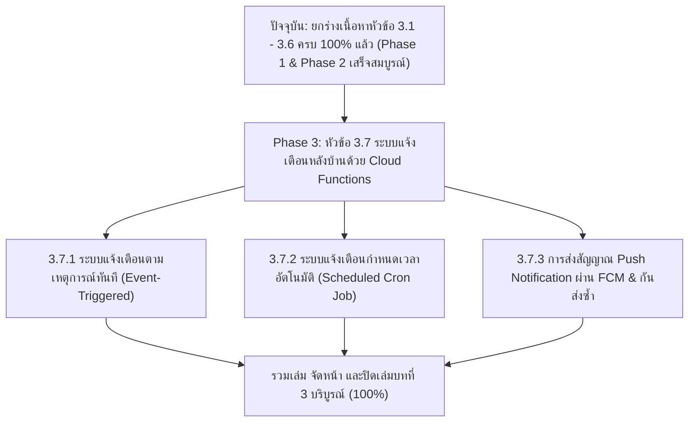

# สรุปสถานะการจัดทำเล่มโครงงาน บทที่ 3 และรายการงานที่ต้องทำต่อ
**แอปพลิเคชันบริหารจัดการแผนงานและติดตามสถานะภาระงาน (Personal Workflow and Task Progress Monitoring Application)**
*หลักสูตรวิทยาศาสตรบัณฑิต สาขาวิชาวิทยาการคอมพิวเตอร์ มหาวิทยาลัยเทคโนโลยีราชมงคลสุวรรณภูมิ*

---

## 1. ภาพรวมสถานะปัจจุบันของบทที่ 3 (Current Progress)

จากการตรวจสอบเล่มโครงงานและการยกร่างเนื้อหาฉบับวิชาการ พบว่าเนื้อหาบทที่ 3 ดำเนินการไปแล้วจนถึง **หัวข้อ 3.6 (ระบบแนวคิดเกม Gamification)** โดยสรุปส่วนที่ทำเสร็จสมบูรณ์แล้วได้ดังนี้:

| หัวข้อ | รายละเอียดเนื้อหาที่ทำเสร็จแล้ว | สถานะ |
| :--- | :--- | :---: |
| **3.1 การวิเคราะห์และออกแบบระบบ** | - กำหนดความต้องการของระบบ (Functional & Non-Functional Requirements) - โฟลว์ชาร์ตไดอะแกรมครบทั้ง 6 ระบบ (ภาพที่ 3-1 ถึง 3-11) - ยูสเคสไดอะแกรม (ภาพที่ 3-12) - ยูสเคสดิสคริปชันทั้ง 12 ยูสเคส (ตารางที่ 3-1 ถึง 3-12) - คลาสไดอะแกรมและคำอธิบายคลาส (ภาพที่ 3-13) | หน้า 23 – 65 ในเล่ม |
| **3.2 การออกแบบสถาปัตยกรรมและโครงสร้างข้อมูล** | - สถาปัตยกรรม Client-Server ผสาน Serverless (Frontend Flutter, Backend Firebase) - โครงสร้างโฟลเดอร์ซอร์สโค้ด (Code Directory Structure) - พจนานุกรมข้อมูล (Data Dictionary) คอลเลกชัน `users`, `tasks`, `notifications` - กฎความปลอดภัย Firestore Security Rules & Policy Matrix (ตารางที่ 3-16) | หน้า 65 – 73 ในเล่ม |
| **3.3 การออกแบบส่วนติดต่อผู้ใช้ (UI/UX)** | - ออกแบบ Wireframe/UI Mockup หน้าจอระบบครบ 10 หน้าจอหลัก (ภาพที่ 3-13 ถึง 3-30) พร้อมคำอธิบายองค์ประกอบการทำงาน | หน้า 74 – 106 ในเล่ม |
| **3.4 การพัฒนาระบบจัดการภาระงานส่วนบุคคล (ครบ 5 ส่วน)** | - **3.4.1 การสร้างภาระงานส่วนบุคคล:** หน้าจอ Modal และโครงสร้างฟิลด์บน Firestore 37 ฟิลด์ - **3.4.2 โค้ดการบันทึกภาระงานส่วนบุคคล:** Client UI Layer & State/Database Layer `addTask` - **3.4.3 การแสดงผลและติดตามงานบนหน้าหลัก:** UI Home Screen, Stream Firestore, จัดกลุ่มงานวันนี้/งานค้าง, ยุบงานซ้ำ, วิดเจ็ต `_TodayTaskCard` - **3.4.4 การเปลี่ยนสถานะงานเสร็จสิ้นและการคำนวณ XP:** Subtasks Validation, Late Penalty, Anti-Farming 5 นาที & Burst 4 งาน, เลเวลอัปโบนัส +50 XP, Undo Transaction - **3.4.5 ระบบถังขยะและการกู้คืนงาน:** Soft Delete, Cascading Delete งานซ้ำ, TTL 30 วัน, กู้คืนงาน, ลบไฟล์ถาวรบน Storage | [✓ เสร็จ 100%] หน้า 106 – 126 ในเล่ม + ส่วนต่อขยาย 21 หน้า |
| **3.5 การพัฒนาระบบโครงการกลุ่มและการทำงานร่วมกัน (ครบ 4 ส่วน)** | - **3.5.1 การสร้างโครงการกลุ่มและจัดการสมาชิก:** คอลเลกชัน `tasks` (type: group), ระบบเพื่อน, กำหนด Leader และ Assignees - **3.5.2 การมอบหมายงานย่อยและกำหนดค่าน้ำหนักงาน:** โมเดลคณิตศาสตร์คำนวณ XP จาก Difficulty, Workload, Risk และออบเจกต์ Member - **3.5.3 การส่งงานของสมาชิกทีม:** ตรวจ Subtasks, พิมพ์สรุปผลงาน, แนบไฟล์/ลิงก์, ปรับสถานะ `pending`, ส่ง Push Notification แจ้งเตือนหัวหน้า - **3.5.4 การตรวจสอบและอนุมัติงานโดยหัวหน้าโครงการ:** ตรวจงาน, อนุมัติแจก XP พร้อมหัก Late Penalty 12%, มอบโบนัสหัวหน้า +10 XP, หรือปฏิเสธลบไฟล์บน Storage | [✓ เสร็จ 100%] ร่างในไฟล์ `chapter3_phase2_group_and_gamification.md` |
| **3.6 การพัฒนาระบบแนวคิดเกม (Gamification) (ครบ 4 ส่วน)** | - **3.6.1 ตรรกะการคำนวณและประมวลผลการเลื่อนระดับ:** สูตร XP 500 ต่อเลเวล (Max 25), โบนัสเลเวลอัป +50 XP, ปลดล็อกกรอบรูป 5 Milestone - **3.6.2 การตรวจสอบและปลดล็อกตราความสำเร็จ:** เกณฑ์เหรียญตราทั้ง 9 รายการ, ฟังก์ชัน `mergedUnlockedAchievementIds`, ป็อปอัปแอนิเมชันปลดล็อก - **3.6.3 ระบบการติดตามสถิติการใช้งานต่อเนื่อง (Streak):** ตรวจ `lastLoginDate` เทียบกับวันวาน, บวกเพิ่มวันละ 1, รีเซ็ตเมื่อขาดช่วง, บันทึก `longestStreak` - **3.6.4 กลไกการตรวจจับและป้องกันการปั๊มคะแนน:** ตรวจอายุงานต่ำกว่า 5 นาทีบล็อก XP, กลไก Burst Allowance จำกัด 4 งานต่อนาที | [✓ เสร็จ 100%] ร่างในไฟล์ `chapter3_phase2_group_and_gamification.md` |

---

## 2. สิ่งที่ค้างอยู่และต้องแก้ไขในส่วนที่เขียนไปแล้ว (Pending Fixes)

1. **3.1.6 ซีเควนไดอะแกรม (Sequence Diagram) (หน้า 65):**
   * *ปัญหา:* ในหน้า 65 มีพิมพ์ค้างไว้เพียงข้อความ `3.1.6 ซีเควนไดอะแกรม (Sequence Diagram) ภาพที่ 3-14 ซีเควนไดอะแกรม` แต่**ยังไม่มีรูปภาพไดอะแกรม และไม่มีคำอธิบายขั้นตอนการทำงาน** แล้วข้ามไปขึ้นหัวข้อ 3.2 ทันที
   * *สิ่งที่ต้องทำ:* ต้องใส่ภาพ Sequence Diagram (อย่างน้อย 1-2 Use Case สำคัญ เช่น กระบวนการสร้างงานและแจ้งเตือน หรือกระบวนการส่งงานกลุ่ม) พร้อมเขียนคำอธิบายลำดับข้อความ (Message Sequence)
2. **3.1.5 คลาสไดอะแกรม (Class Diagram) (หน้า 63):** [✓ แก้ไขเสร็จสิ้นแล้ว]
   * ผู้จัดทำได้ทำการปรับปรุงภาพใหม่ลงในเล่มแล้ว โดยเปลี่ยนเป็น `- userId: String`, ลบ `subTasks` ในกล่องออก และโยงเส้น `1` ไปยัง `SubTask 0..*` ตามที่อาจารย์แนะนำเรียบร้อยแล้ว
3. **การรันหมายเลขภาพ (Figure Numbering) ในหัวข้อ 3.4, 3.5, 3.6:**
   * *ปัญหา:* ใต้ภาพหน้า 107 ถึง 126 และในเอกสารต่อขยาย ยังพิมพ์ค้างเป็น `ภาพที่ 3- ...` และ `ภาพที่ 3-xx` โดยเว้นว่างหมายเลขภาพไว้
   * *สิ่งที่ต้องทำ:* รันเลขภาพให้ต่อเนื่องตั้งแต่ภาพที่ 3-31 เป็นต้นไปจนจบเนื้อหาทั้งบท

---

## 3. สิ่งที่ต้องเขียนต่อในบทที่ 3 (Remaining Section)

ปัจจุบันเนื้อหาบทที่ 3 ดำเนินการยกร่างเสร็จสิ้นไปแล้วกว่า **85%** (หัวข้อ 3.1 ถึง 3.6 สมบูรณ์แล้ว)! หัวข้อสุดท้ายที่จะต้องเขียนเพื่อปิดเล่มบทที่ 3 คือ **หัวข้อ 3.7 ระบบแจ้งเตือนหลังบ้านอัจฉริยะด้วย Cloud Functions** ดังนี้:

---

### รายละเอียดของหัวข้อ 3.7 ที่ต้องจัดทำต่อไป (Phase 3 Scope):

### 🔹 หัวข้อ 3.7: การพัฒนาระบบแจ้งเตือนหลังบ้านอัจฉริยะด้วย Cloud Functions
* **3.7.1 ระบบแจ้งเตือนตามเหตุการณ์ทันที (Event-Triggered Notifications):**
  * ฟังก์ชันตรวจจับกิจกรรม เช่น เมื่อมีการเชิญเข้ากลุ่ม, สมาชิกส่งงานรอตรวจ, หัวหน้าอนุมัติ/ปฏิเสธงาน, หรือส่งคำขอเป็นเพื่อน
  * การตรวจสอบความถูกต้องของข้อมูล (Data Validation) และการดึง `fcmToken` ของผู้รับ
* **3.7.2 ระบบแจ้งเตือนกำหนดเวลาอัตโนมัติ (Scheduled Cron Job):**
  * การตั้งเวลาทำงานอัตโนมัติทุก 1 นาที (Cron Job `* * * * *`)
  * ตรรกะการคำนวณเวลาเพื่อแจ้งเตือน 3 ช่วงเวลา:
    1. เตือนล่วงหน้าตามที่ผู้ใช้กำหนด (เช่น 30 นาที, 1 ชั่วโมง, 1 วัน)
    2. เตือนเมื่อถึงเวลาครบกำหนดส่งพอดี (0 นาที)
    3. เตือนติดตามผลเมื่องานเลยกำหนดส่งไปแล้ว 30 นาที
* **3.7.3 การส่งสัญญาณ Push Notification ผ่าน FCM และการป้องกันการส่งซ้ำ:**
  * การประกอบ Message Payload (Notification Body, Priority: High, Channel ID)
  * การอัปเดตแฟล็กป้องกันการส่งซ้ำใน Firestore (`notified1Hour`, `notifiedExact`, `notifiedFollowUp`)
  * การจัดการ Token ที่หมดอายุหรือผู้ใช้ถอนการติดตั้งแอป (Token Invalidation Handling)

---

## 4. แผนงานและสรุปผลการดำเนินงานตามระยะ (Action Roadmap)

| ระยะการดำเนินงาน (Phase) | รายละเอียดงาน | ผลลัพธ์ที่ได้ (Deliverables) | สถานะปัจจุบัน |
| :--- | :--- | :--- | :---: |
| **Phase 1: แก้ไขจุดค้างเดิม & จบข้อ 3.4** | 1. ปรับปรุง Class Diagram 2. เขียนข้อ 3.4.3, 3.4.4, 3.4.5 (แสดงงาน, จบงาน, ถังขยะ) 3. เพิ่มคอมเมนต์ในโค้ดสำหรับแคปภาพ | เนื้อหาระบบงานส่วนบุคคลสมบูรณ์ 100% (หน้า 106-126 + ส่วนต่อขยาย 21 หน้า) | **[✓ เสร็จสมบูรณ์แล้ว]** |
| **Phase 2: พัฒนางานกลุ่ม & Gamification** | 1. เขียนข้อ 3.5 ระบบงานกลุ่ม (สร้าง, มอบหมาย, ส่งงาน, อนุมัติ) 2. เขียนข้อ 3.6 ระบบ Gamification (สูตรเลเวล, ตราความสำเร็จ, Streak, Anti-Farming) | ยกร่างเอกสารวิชาการข้อ 3.5 และ 3.6 ครบถ้วนใน `chapter3_phase2_group_and_gamification.md` | **[✓ เสร็จสมบูรณ์แล้ว]** |
| **Phase 3: หลังบ้านแจ้งเตือน & ปิดเล่มบทที่ 3** | 1. เขียนข้อ 3.7 Cloud Functions และ FCM (Cron Job, แจ้งเตือนทันที, กันส่งซ้ำ) 2. Sequence Diagram (ข้อ 3.1.6) 3. รันเลขภาพและตรวจทานปิดเล่มบทที่ 3 | เล่มโครงงานบทที่ 3 เสร็จสมบูรณ์ 100% พร้อมส่งอาจารย์ที่ปรึกษาตรวจ | **[เป้าหมายถัดไป]** |
